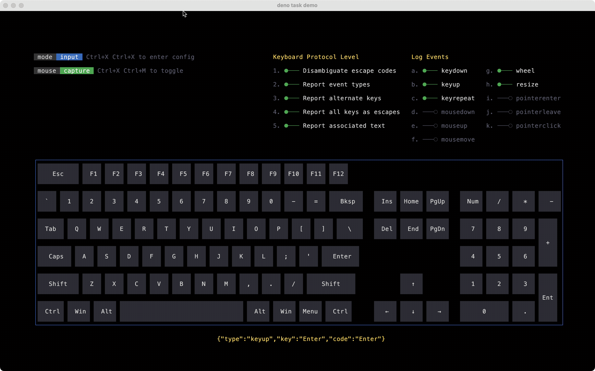
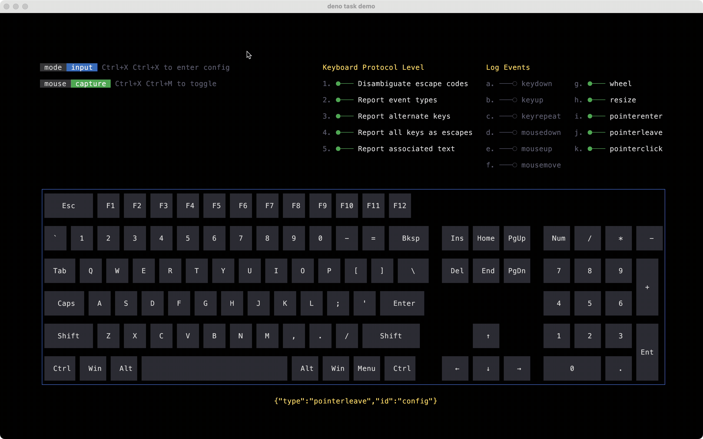

# @bomb.sh/tty

A low-level, platform-independent terminal renderer and event parser for
JavaScript. You can use `@bomb.sh/tty` directly, or as the foundation for your
own framework.

## Features

**Declarative terminal UI** — Build terminal interfaces the same way you'd build
a web page. `@bomb.sh/tty` uses [Clay](https://github.com/nicbarker/clay) under
the hood, giving you flexbox-like layout, pointer detection, and scroll
containers — all rendered to the terminal as box-drawing characters and ANSI
escape sequences.

**Zero I/O** — `@bomb.sh/tty` never reads stdin or writes stdout. You feed it
bytes and get bytes back. This makes it trivially embeddable in any framework,
any runtime, any event loop. There are no opinions about how you do I/O, just
pure computation.

**Portable engine** — WebAssembly provides a portable backend without native
dependencies. Node.js uses a matching packaged `.node` addon when available,
with the same TypeScript API. When no matching addon is packaged, it uses
WebAssembly.

### Local native build and benchmarks

Initialize the pinned Clay dependency, then build both backends:

```sh
git submodule update --init --recursive
make
make native
node bench/native.bench.ts
```

The Wasm build requires Clang with a wasm32 target and `wasm-ld`. The native
build supports macOS and Linux and requires a C11 compiler, Deno, Node.js, and
Node development headers. Set `NODE_INCLUDE_DIR` if `node_api.h` is not in
`../include/node` relative to the Node executable; `CC` selects the compiler.

`make native` writes a platform-specific addon to `native/`. Node.js selects
that addon automatically; Deno and Bun use Wasm. A present addon that fails to
load reports the error. `deno task build:npm <version>` includes the locally
built addon in the npm artifact. Builds for other platforms require their own
native artifacts; cross-platform binary distribution is not automated.

The benchmark uses isolated copies of the same TypeScript code, with an addon
present only in the native copy. It measures the rendering workloads from
`bench/render.bench.ts`, mixed input throughput, and startup in fresh Node
processes. Raw results and methodology are written to
`build/native-benchmark.json`.

Run the existing suite in Wasm and native Node.js, plus native renderer lifetime
and worker checks:

```sh
deno task test
deno run -A tasks/build-npm.ts 0.0.0-test --test
node --expose-gc --test test/native-renderer.node.ts
```

### Examples

See this keyboard example and more in the [examples folder](examples/README.md).
This demo uses `@bomb.sh/tty` for all layout and input parsing.

#### Keyboard Events

The input parser decodes raw terminal bytes into structured events. Here you can
see each key event as the string "hello world" is typed.



#### Pointer Events

Here we see hover styles applied to UI elements in response to the pointer
state. Clay drives the hit testing; no manual coordinate math required.



## Architecture

`@bomb.sh/tty` does not do any I/O itself. On the ouput side, it converts UI
elements into a raw sequence of bytes and pointer events, and on the input side,
it converts a stream of raw bytes into structured events.

### Output

With every frame, the entire UI tree is packed into a flat byte array and sent
to the C engine in a single call. On the C side, Clay runs layout, render
commands are walked into a cell buffer, and the buffer is diffed against the
previous frame. Only the cells that actually changed produce output. The result
is an ANSI escape sequence that can be written directly to stdout. One engine
render call per frame, double buffered, and only the bytes that need to change
hit the output stream.

The engine performs pure computation with no terminal I/O. Its Wasm backend runs
in Deno, Node, Bun, browsers, or any other runtime.

```
 TypeScript                        WASM (C)
+---------------+                +---------------------------+
|               |  Uint32Array   |                           |
| UI ops...     | =============> | Clay layout               |
|               |                |   -> render commands      |
+---------------+                |   -> cell buffer (back)   |
                                 |   -> diff against (front) |
                                 |   -> escape bytes         |
+---------------+                |                           |
|               | ANSI byte array|                           |
| stdout.write  | <============= |                           |
|               |                |                           |
+---------------+                +---------------------------+
```

### Input

Raw bytes from stdin are fed into a C parser that recognizes VT/ANSI escape
sequences, UTF-8 codepoints, and mouse protocols (VT200, SGR, urxvt). The parser
maintains its own internal buffer so partial sequences that arrive across read
boundaries are reassembled automatically. A lone ESC byte is held for a
configurable latency window (default 25ms) before being emitted, giving
multi-byte sequences time to arrive.

```
 TypeScript                        WASM (C)
+---------------+                +---------------------------+
|               |  raw byte array|                           |
| stdin.read    | =============> | trie match (keys/seqs)    |
|               |                |   -> mouse protocol       |
|               |                |   -> UTF-8 decode         |
+---------------+                |   -> ESC codes            |
                                 |                           |
+---------------+                |                           |
|               |  events[]      |                           |
| KeyEvent      | <============= |                           |
| MouseDownEvent|                |                           |
| MouseUpEvent  |                +---------------------------+
| MouseMoveEvent|
| WheelEvent    |
| ResizeEvent   |
+---------------+
```

## Usage

### Rendering

To render this:

```
╭───────────────╮
│ Hello, World! │
╰───────────────╯
```

```typescript
import { close, createTerm, open, rgba, text } from "@bomb.sh/tty";

let term = await createTerm({ width: 80, height: 24 });

let { output } = term.render([
  open("greeting", {
    layout: { padding: { left: 1, right: 1, top: 1, bottom: 1 } },
    border: {
      color: rgba(0, 255, 0),
      left: 1,
      right: 1,
      top: 1,
      bottom: 1,
    },
    cornerRadius: { tl: 1, tr: 1, bl: 1, br: 1 },
  }),
  text("Hello, World!"),
  close(),
]);

process.stdout.write(output);
```

### Pointer detection

Pass pointer state to `render()` to have `@bomb.sh/tty` do hit detection and
return pointer events in addition to the byte sequence.

```typescript
import { close, createTerm, fixed, grow, open, rgba, text } from "@bomb.sh/tty";

let term = await createTerm({ width: 80, height: 24 });

let { output, events } = term.render(
  [
    open("root", {
      layout: { width: grow(), height: grow(), direction: "ltr" },
    }),
    open("sidebar", {
      layout: { width: fixed(20), height: grow() },
      bg: rgba(30, 30, 40),
    }),
    text("Sidebar"),
    close(),
    open("main", {
      layout: { width: grow(), height: grow() },
    }),
    text("Main content"),
    close(),
    close(),
  ],
  {
    pointer: { x: mouseX, y: mouseY, down: mouseDown },
  },
);

for (let event of events) {
  // { type: "pointerenter", id: "sidebar" }
  // { type: "pointerleave", id: "sidebar" }
  // { type: "pointerclick", id: "main" }
  console.log(event);
}

process.stdout.write(output);
```

### Input parsing

```typescript
import { createInput } from "@bomb.sh/tty";

let input = await createInput({ escLatency: 25 });

process.stdin.setRawMode(true);
let timer: ReturnType<typeof setTimeout> | undefined;

process.stdin.on("data", (buf) => {
  clearTimeout(timer);

  let { events, pending } = input.scan(new Uint8Array(buf));

  for (let event of events) {
    dispatch(event);
  }

  // if a lone ESC is pending, wait and re-scan to flush it
  if (pending) {
    timer = setTimeout(() => {
      let flush = input.scan();
      for (let event of flush.events) {
        dispatch(event);
      }
    }, pending.delay);
  }
});
```

## Development

For local source builds, toolchain setup, and `clay` submodule instructions, see
[BUILD.md](BUILD.md).

Quick local validation:

```sh
make
deno task test
```
